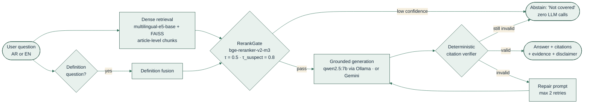
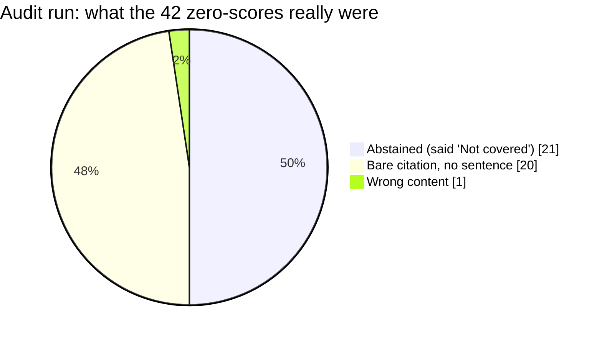
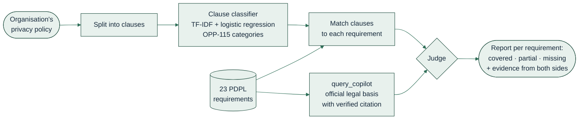

[README_final.md](https://github.com/user-attachments/files/34233413/README_final.md)
<p align="center">
  
</p>

<p align="center"><b>«امتثالٌ بدليل»</b> · <i>Compliance, with evidence</i></p>

<p align="center">
  
  
  
  
</p>
<p align="center">
  
  
  
  
  <a href="https://colab.research.google.com/github/Hanan-codes/PDPL-Compliance-Copilot/blob/main/notebooks/Rag_stage3_CLEAN_Colab_Ollama.ipynb"></a>
</p>

<p align="center">
  <a href="#-pick-your-path">Pick your path</a> ·
  <a href="#-how-it-works">How it works</a> ·
  <a href="#-results-at-a-glance">Results</a> ·
  <a href="#-quick-start">Quick start</a> ·
  <a href="#-the-sanad-app">The app</a> ·
  <a href="#-repository-map">Repo map</a> ·
  <a href="#-limitations--next-steps">Limitations</a>
</p>

> **Not legal advice.** SANAD retrieves and quotes official text from the Saudi Personal Data Protection Law (PDPL), its Implementing Regulation and related SDAIA guidance. It is a research assistant, not a substitute for a qualified lawyer.

---

## 🧭 Pick your path

| I am… | Start here | Time |
|---|---|---|
| 🎓 **A reviewer / committee member** who wants to see the system and the experiments | [`docs/RAG_Report_Stages1-3.md`](docs/RAG_Report_Stages1-3.md) for the final numbers, then [`notebooks/`](notebooks/Rag_stage3_CLEAN_Colab_Ollama.ipynb) for the code | 15 min |
| 💻 **A developer** who wants to call the copilot from code | [`src/rag_inference.py`](src/rag_inference.py) · [`docs/rag_inference_guide.md`](docs/rag_inference_guide.md) | 5 min |
| 🔬 **An evaluator** who wants to check the numbers | [`data/stage2_outputs/`](data/stage2_outputs) (retrieval metrics) · [`docs/RAG_Report_Stages1-3.md`](docs/RAG_Report_Stages1-3.md) | 10 min |
| 🖥️ **A user** who wants the interface: ask questions and analyse a privacy policy | [The SANAD app](#-the-sanad-app) · [`app/`](app/) | 3 min |
| ⚡ **Just curious** whether the safety layer really works | [Run the 5-second verifier test](#1-prove-the-safety-layer-in-5-seconds-no-gpu-no-llm) | 5 sec |

---

## 💡 The idea in 30 seconds

Saudi data-protection obligations are scattered across the law, its Implementing Regulation, transfer rules, DPO-appointment rules and sector guidance, in **Arabic and English**. General-purpose LLMs answer confidently, cite articles that do not exist, and borrow from other laws such as GDPR. In compliance work, **a confident wrong answer costs more than no answer.**

SANAD is built on one contract:

> ### Every sentence is backed by a verifiable citation to an official article.<br/>If no such evidence exists, the system says so and stops.

<details>
<summary><b>🇸🇦 ملخص بالعربية (اضغط للفتح)</b></summary>

<div dir="rtl">

**سَنَد** مساعد امتثال لنظام حماية البيانات الشخصية السعودي ولائحته التنفيذية، يجيب بالعربية والإنجليزية. كل جملة في الإجابة تستند إلى مادة رسمية يمكن التحقق منها، وإذا لم يوجد دليل كافٍ يمتنع النظام عن الإجابة بدل أن يخمّن.

- **استرجاع** على مستوى المادة بتضمين متعدد اللغات، ثم **بوابة ثقة** قبل أي توليد.
- **تحقق حتمي من الاستشهادات** مع إعادة محاولة محدودة ثم امتناع.
- **النتائج:** 0% استشهادات وهمية · 78/78 استشهاداً صحيحاً · امتناع صحيح 93.3% · صحة بشرية 93.4%.
- **التطبيق:** واجهة Streamlit للأسئلة، وتحليل سياسة الخصوصية مقابل 23 متطلباً، مجلد [`app/`](app/).
- **تنبيه:** سَنَد ليس استشارة قانونية.

</div>

</details>

---

## ⚙️ How it works



<table>
<tr>
<td width="25%"><b>🚪 1. Gate before you generate</b><br/>A cross-encoder decides whether the evidence is strong enough <i>before</i> any LLM call. Weak evidence means "Not covered" at zero LLM cost.</td>
<td width="25%"><b>🔎 2. Verify after you generate</b><br/>A deterministic parser checks every <code>[Source | Article]</code> tag against the exact passages retrieved: right document, right article, present in context.</td>
<td width="25%"><b>🛠️ 3. Repair, then refuse</b><br/>Invalid output gets up to two targeted repair prompts. If it still fails, SANAD abstains rather than ship an unverified claim.</td>
<td width="25%"><b>📖 4. Definitions first</b><br/>Definition questions get a dedicated retrieval path, so "what counts as personal data?" returns the exact legal wording.</td>
</tr>
</table>

### The three stages

| Stage | What it does | Output |
|---|---|---|
| **1 · Data & Chunking** | Loads 4 corpora (AR/EN × article/fixed), normalises Arabic for **search only** (original legal text is preserved), splits the Definitions article into one chunk per term | 912 validated chunks · 0 empty · 0 duplicate IDs |
| **2 · Retrieval** | Benchmarks BM25, dense (E5), hybrid (RRF) and hybrid + cross-encoder rerank, monolingual and cross-lingual; builds one FAISS index per corpus | Recall@5 / MRR@5 per method and language |
| **3 · Grounded Generation** | Confidence gate → citation-constrained generation → deterministic verification → repair or abstain; evaluated end to end on 83 questions | 0% hallucinated citations · 93.3% correct abstention |

> **Design note.** The notebook benchmarks the full hybrid pipeline (BM25 + E5 → RRF → bge-reranker). The standalone `query_copilot` uses **E5 dense retrieval with the reranker acting as a confidence gate**, following Stage 2, where dense retrieval had the highest Recall@5 (0.955 AR · 0.958 EN) and the reranker adds the most value as a precision filter that decides whether to answer at all.

---

## 📊 Results at a glance

> **Where the numbers come from.** Retrieval figures are computed from the CSVs in [`data/stage2_outputs/`](data/stage2_outputs) and [`data/stage1_outputs/`](data/stage1_outputs). Generation and human-evaluation figures come from the final end-to-end run (83 questions, `qwen2.5:7b`), documented in [`docs/RAG_Report_Stages1-3.md`](docs/RAG_Report_Stages1-3.md). The notebook's saved cell outputs are from an **earlier run** and were not re-executed (GPU quota ran out), so the report is the source of truth.

### Generation: from fluent to trustworthy (same 83 questions)

| Behaviour | LLM only | Naive RAG | **SANAD** |
|---|---|---|---|
| Abstains on out-of-scope questions | 0 / 15 | 0 / 15 | **14 / 15 (93.3%)** |
| Citations to non-existent sources | 25.0% | 1.2% | **0%** |
| Valid citations (right document, in context) | — | 85% | **100% (78 / 78)** |
| Fabricated verbatim quotes | — | — | **0 / 63** |

On one dev batch (n = 24) the raw LLM draft had a **21.4%** hallucinated-citation rate; after the verifier and repair it dropped to **0.0%**.

### Retrieval: from keywords to meaning (article-level chunks)

| Metric | BM25 (before) | Hybrid + rerank (after) | Change |
|---|---|---|---|
| Arabic Recall@5 | 0.455 | **0.909** | ×2.0 |
| Arabic MRR@5 | 0.281 | **0.845** | ×3.0 |
| English Recall@5 | 0.500 | **0.833** | ×1.7 |
| English MRR@5 | 0.361 | **0.764** | ×2.1 |

<details>
<summary><b>🌍 Cross-lingual retrieval (experiment E3): an Arabic question can find English evidence</b></summary>

<br/>

| Question → Corpus | English-only embedding | **Multilingual embedding** |
|---|---|---|
| Arabic → English | 0.156 | **0.938** |
| English → Arabic | 0.095 | **0.762** |
| Arabic → Arabic | 0.062 | **0.938** |
| English → English | 0.875 | **0.958** |

<sub>Recall@5. An English-only embedding collapses on Arabic.</sub>

</details>

<details>
<summary><b>🧾 Full scorecard (end to end, 83 questions, qwen2.5:7b via Ollama)</b></summary>

<br/>

| Metric | Arabic | English | **All** |
|---|---|---|---|
| Questions (answerable / unanswerable) | 44 / 10 | 24 / 5 | **68 / 15** |
| Recall@5 (hybrid + rerank) | 0.909 | 0.833 | **0.882** |
| MRR@5 | 0.845 | 0.764 | **0.817** |
| Citation validity | 43 / 43 | 35 / 35 | **78 / 78** |
| Fabricated verbatim quotes | 0 | 0 | **0** |
| Lexical evidence-support check | 90.0% | 76.9% | **84.8%** |
| Correct abstention on unanswerable | 10 / 10 | 4 / 5 | **14 / 15 (93.3%)** |
| False refusal on answerable | 3 / 44 | 2 / 24 | **5 / 68 (7.4%)** |
| Execution errors | 0 | 0 | **0** |

**Held-out test split** (τ = 0.5 fixed in advance, never tuned on test): abstention **7 / 7**, false refusal **3 / 37 (8.1%)**.

</details>

### 🧑‍⚖️ Humans in the loop

Automated metrics measure **safety** (is each citation real?). Only a human can judge **usefulness** (does the answer actually answer?). So every answer was read and graded 0–2.



| Finding from the audit | Fix | Effect |
|---|---|---|
| **Over-caution**: 21 answers abstained, and in 14 of them the right evidence was already in the top-5 | Definition fusion, force-keep, language-aware gate thresholds | Wrong refusals **21 → 5** |
| **Bare citations**: 20 answers were only a `[Source \| Article]` tag with no sentence (a citation metric scores these as perfect) | RULE 2B prompt: "state the answer in words, never cite alone" | Bare-citation answers **20 → 1** |

**Final-run human evaluation (two independent raters):**

| Metric | Rater 1 | Rater 2 | Inter-rater mean |
|---|---|---|---|
| Mean grade (out of 2) | 1.81 | 1.93 | **1.87** |
| Correctness (mean ÷ 2) | 90.4% | 96.3% | **93.4%** |
| Fully correct answers (grade 2) | 60 (88.2%) | 65 (95.6%) | 60 (88.2%) |
| Wrong answers (grade 0) | 5 | 2 | 2 |

---
### 🏷️ Clause classifier (experiment E4): TF-IDF + LR vs fine-tuned BERT

The gap analyser labels each policy clause with one of the ten OPP-115 data-practice categories. E4 asks whether a fine-tuned transformer beats a TF-IDF + logistic-regression baseline on that task. Scores are on **372 test segments from 12 policies the models never saw** (policies are split, never segments).

| Metric (test set) | TF-IDF + LR | Fine-tuned BERT |
|---|---|---|
| Macro-F1, per-class thresholds | 0.809 | **0.839** |
| Macro-F1, default 0.5 threshold | 0.831 | 0.830 |
| Micro-F1, per-class thresholds | 0.791 | **0.828** |
| Micro-F1, default 0.5 threshold | 0.796 | **0.824** |
| Macro-F1 95% interval (policy bootstrap) | 0.762 – 0.872 | 0.796 – 0.907 |

<sub>Thresholds are tuned per category on validation and the test set is scored once. Intervals come from resampling the 12 test policies 1,000 times.</sub>

**What it shows**

- **No clear winner.** BERT is ahead with tuned thresholds (macro-F1 +0.030), but at the default 0.5 threshold the two are tied (0.831 vs 0.830) and the intervals overlap heavily.
- **BERT's edge is on frequent categories.** Micro-F1, which is dominated by the large categories, is higher in both settings (+0.037 and +0.028), while macro-F1, which weights every category equally, is not.
- **Threshold tuning is fragile.** It helped BERT slightly (0.830 → 0.839) and hurt the baseline (0.831 → 0.809). With only 11 validation policies, a threshold fitted to a handful of examples does not transfer: for the baseline, Data retention fell from F1 0.909 to 0.625.
- **The app ships TF-IDF + LR.** It runs on CPU with no model download. The fine-tuned BERT is an experiment and is not part of the deployed app.

<details>
<summary><b>🧪 How E4 was run</b></summary>

<br/>

- **Data:** 3,792 OPP-115 segments. A category becomes a label when at least 2 of the 3 annotators chose it; 63 segments with no such agreement are excluded, leaving **3,729** (3,005 train · 352 validation · 372 test).
- **Split:** by policy, **92 / 11 / 12** policies. No policy appears in two splits.
- **Baseline:** TF-IDF (word 1–2-grams, `min_df` 2, sublinear TF) + one-vs-rest logistic regression (balanced class weights, C = 4).
- **Transformer:** `bert-base-uncased`, sigmoid outputs, binary cross-entropy with `pos_weight = sqrt(neg/pos)`, max length 256, batch 16, learning rate 3e-5, weight decay 0.01, 10% warm-up, seed 42. Best epoch 5 of 6, chosen on validation macro-F1.
- **Metrics:** per-category precision, recall and F1, plus macro-F1. Macro-F1 is the headline because a segment carries about 1.15 of 10 possible labels, so plain accuracy rewards predicting nothing.
- **Reproduce:** `OPP115_Build_Segments_Dataset.ipynb` → `OPP115_E4_Baseline_TFIDF_LR.ipynb` → `OPP115_E4_Transformer_FineTune.ipynb`.

</details>

<details>
<summary><b>📋 Per-category results (TF-IDF + LR baseline, test set)</b></summary>

<br/>

| Category | Test segments | Precision | Recall | F1 |
|---|---|---|---|---|
| First-party collection/use | 126 | 0.906 | 0.762 | 0.828 |
| Other | 96 | 0.824 | 0.583 | 0.683 |
| Third-party sharing/collection | 93 | 0.745 | 0.849 | 0.794 |
| User choice/control | 30 | 0.880 | 0.733 | 0.800 |
| International & specific audiences | 30 | 0.966 | 0.933 | 0.949 |
| Data security | 19 | 0.640 | 0.842 | 0.727 |
| User access, edit & deletion | 14 | 0.765 | 0.929 | 0.839 |
| Policy change | 12 | 0.786 | 0.917 | 0.846 |
| Data retention | 6 | 0.500 | 0.833 | 0.625 |
| Do not track | 3 | 1.000 | 1.000 | 1.000 |

<sub>Do not track (3 segments) and Data retention (6) are too small to interpret on their own.</sub>

> **TODO:** add the fine-tuned BERT per-category precision, recall and F1 from `e4_transformer_per_class_metrics.csv`.

</details>

<details>
<summary><b>⚠️ E4 limitations</b></summary>

<br/>

- **Domain gap.** Both models were trained on US-English website policies. E4 does not measure accuracy on Saudi policies.
- **Category gaps.** The ten OPP-115 categories have no dedicated label for cross-border transfer or breach notification, two PDPL requirements the gap analyser must still judge.
- **Small test set.** 12 policies, so differences of a few points between the models are within noise.
- **Label rule.** The two-of-three majority rule is a design choice; it removes 63 segments and cuts multi-label segments from 52% (union of annotators) to 18%.

</details>
## 🚀 Quick start

```bash
git clone https://github.com/Hanan-codes/PDPL-Compliance-Copilot.git
cd PDPL-Compliance-Copilot
pip install -r requirements-rag.txt
```

> First full run downloads about 3.5 GB of models (`multilingual-e5-base`, `bge-reranker-v2-m3`). CPU works; a GPU speeds up the reranker.

### 1) Prove the safety layer in 5 seconds (no GPU, no LLM)

```python
import sys; sys.path.insert(0, "src")
import rag_inference as rag

ctx = [rag.Chunk(chunk_id="pdpl_ar_001", document_id="pdpl", language="ar",
                 article_numbers=(1,), article_title="التعريفات",
                 text="البيانات الشخصية: كل بيان من شأنه أن يؤدي إلى معرفة الفرد.")]

cases = {
  "grounded":     "البيانات الشخصية كل بيان يؤدي إلى معرفة الفرد. [المصدر: pdpl | المادة: 1]",
  "hallucinated": "البيانات الشخصية كل بيان يؤدي إلى معرفة الفرد. [المصدر: pdpl | المادة: 250]",
  "no_citation":  "البيانات الشخصية كل بيان يؤدي إلى معرفة الفرد.",
  "abstention":   rag.ABSTAIN_TEXT,
}
for name, ans in cases.items():
    print(f"{name:13s} -> {rag.verify_citations(ans, ctx).status}")
```

```text
grounded      -> VALID
hallucinated  -> INVALID_CITATION        # Article 250 does not exist in the context
no_citation   -> NO_CITATION
abstention    -> ABSTAINED
```

### 2) Ask the copilot

<details open>
<summary><b>Option A · Ollama (local, private)</b></summary>

```bash
ollama serve &
ollama pull qwen2.5:7b

STAGE_DATA_DIR=./data LLM_PROVIDER=ollama \
python src/rag_inference.py "ما المقصود بالبيانات الشخصية في النظام؟"
```

</details>

<details>
<summary><b>Option B · Gemini (cloud)</b></summary>

```bash
export GEMINI_API_KEY="your-key"        # never commit this
STAGE_DATA_DIR=./data LLM_PROVIDER=gemini \
python src/rag_inference.py "What does the PDPL mean by 'Personal Data'?"
```

</details>

<details>
<summary><b>Option C · Mock provider (test the plumbing, no model needed)</b></summary>

The built-in `mock` provider is a deterministic extractive simulator that **deliberately injects fake citations 25% of the time**, so you can watch the verifier catch them. It tests the pipeline only and says nothing about answer quality.

```bash
LLM_PROVIDER=mock STAGE_DATA_DIR=./data python src/rag_inference.py "ما المقصود بالبيانات الشخصية في النظام؟"
```

</details>

### 3) Use it from your own code

```python
import os, sys
os.environ.update(STAGE_DATA_DIR="data", LLM_PROVIDER="ollama")
sys.path.insert(0, "src")
import rag_inference as rag

rag.load_pipeline("ollama")
r = rag.query_copilot("ما المقصود بمعالجة البيانات الشخصية؟")
print(r["answer"], r["citations_valid"], r["abstained"])
```

<details>
<summary><b>📦 What <code>query_copilot</code> returns</b></summary>

| Key | Meaning |
|---|---|
| `answer` | Grounded answer, every sentence ending in `[المصدر: <doc> \| المادة: <n>]`, or the abstention text |
| `abstained` | `True` if the system declined to answer |
| `citations` / `citations_valid` | Parsed citations and the verifier's verdict |
| `evidence` | Supporting sentences from the cited passages |
| `retrieved` | Retrieved `document\|article` keys |
| `definition_fusion` | `True` when the definition path fired |
| `disclaimer` | "Not legal advice" notice in the question's language |

`query_copilot_json(...)` returns the same result as a JSON string.

</details>

<details>
<summary><b>🧪 Behaviour probes: what to expect</b></summary>

| Probe | Example | Expected behaviour |
|---|---|---|
| Definition | "ما المقصود بالبيانات الشخصية في النظام؟" | Verbatim legal definition, cites `pdpl \| 1` |
| Cross-lingual | Arabic question about a provision | Arabic answer, cited to the official article |
| Out of scope | "What is the maximum GDPR fine?" | `abstained = True`, "Not covered" |
| Real-world instance | "Did company X violate the PDPL last year?" | Stricter gate (τ = 0.8); expected to abstain |

</details>

<details>
<summary><b>🎛️ Configuration (environment variables)</b></summary>

| Variable | Default | Purpose |
|---|---|---|
| `STAGE_DATA_DIR` | `/content/data` | Root folder searched (recursively) for the corpora and FAISS indexes. In this repo use `./data` |
| `LLM_PROVIDER` | `ollama` when run as a script | `ollama` · `gemini` · `openai` · `mock` |
| `OLLAMA_MODEL` / `OLLAMA_HOST` | `qwen2.5:7b` / `http://localhost:11434` | Local model settings |
| `GEMINI_API_KEY` / `GEMINI_MODEL` | — | Cloud model settings |
| `S3_TOP_K` | `5` | Passages retrieved per question |
| `S3_TAU` / `S3_TAU_SUSPECT` / `S3_TAU_KEEP` | `0.5` / `0.8` / `0.2` | Gate thresholds (Arabic) |
| `S3_TAU_EN` / `S3_TAU_KEEP_EN` | `0.0` / `0.0` | Gate thresholds (English) |
| `S3_MAX_REPAIRS` | `2` | Repair attempts before abstaining |
| `S3_USE_GATE` | `1` | Set to `0` to disable the gate (ablation) |
| `S3_OUT_DIR` | `.` | Where the optional LLM cache (`llm_cache.jsonl`) is written |

</details>

<details>
<summary><b>☁️ Run the full notebook on Google Colab</b></summary>

1. Click the **Open in Colab** badge at the top (for a private repo, sign in to Colab with the GitHub account that has access).
2. Upload the `data/` folder to `/content/data` (or mount Google Drive and point `STAGE_DATA_DIR` to it).
3. Run the cells in order. The cell `FINAL END-TO-END EVALUATION` reproduces the metrics, experiments and outputs. *Reviewers do not need to re-run it: the saved outputs are from an earlier run, and the final numbers are in the report.*

Each stage can run on its own because the Stage 1 and Stage 2 outputs ship in `data/`.

</details>

---

## 🖥️ The SANAD app

A Streamlit interface in the SANAD identity, with three tabs: **Ask**, **Policy gap analysis** and **Glossary**. It lives in [`app/`](app/) and reuses the same pipeline.



| Tab | What you do | What you get |
|---|---|---|
| **Ask** | Type a PDPL question in Arabic or English | A grounded answer with citations, evidence, or an honest "Not covered" |
| **Policy gap analysis** | Paste or upload a privacy policy | Coverage per requirement (covered / partial / missing) with evidence |
| **Glossary** | Look up a legal term | The exact wording of the official definition |

```bash
pip install -r app/requirements.txt
STAGE_DATA_DIR=./data streamlit run app/app.py
```

Then, in the sidebar, choose the provider (Ollama or Gemini), confirm the data folder and press **Connect / Initialise**. For Ollama run `ollama serve` and `ollama pull qwen2.5:7b` first. For Gemini paste the API key in the sidebar; it is kept for the session only.

<details>
<summary><b>⚠️ Honest limits of the gap analyser</b></summary>

- The clause classifier is English-only, so Arabic policies need translation before classification.
- It was evaluated on 10 real Saudi policies with labels that the team reviews before sign-off.
- A requirement with no matching clause is reported as **missing / requires human review**, never as a legal violation.

</details>

---

## 🗺️ Repository map

```text
PDPL-Compliance-Copilot/
├── README.md                          ← you are here
├── requirements-rag.txt               ← RAG pipeline dependencies
├── assets/
│   └── banner.svg
├── app/                               ← Streamlit app + gap analyser + clause classifier
│   ├── app.py
│   ├── gap_analyser.py · gap_analyser_inference.py
│   ├── clause_classifier_inference.py · e4_tfidf_lr_model.joblib
│   ├── pdpl_requirements_checklist.json   ← 23 PDPL requirements
│   ├── rag_inference.py               ← copy of src/rag_inference.py (keep in sync)
│   └── requirements.txt
├── notebooks/
│   └── Rag_stage3_CLEAN_Colab_Ollama.ipynb   ← full system + experiments E1–E5 + evaluation
├── src/
│   └── rag_inference.py               ← standalone inference, one entry point
├── docs/
│   ├── RAG_Report_Stages1-3.md        ← technical report
│   └── rag_inference_guide.md         ← inference guide
├── data/
│   ├── stage1_outputs/                ← chunks + metadata (4 corpora)
│   └── stage2_outputs/                ← FAISS indexes + retrieval results
```

### Knowledge base

| Corpus | Chunks | Article-ID coverage |
|---|---|---|
| `ar_article` | 215 | 75.3% |
| `ar_fixed` | 241 | 71.4% |
| `en_article` | 275 | 100% |
| `en_fixed` | 181 | 100%* |

<sub>* via `covered_article_numbers`. The plain `article_number` field of fixed-size chunks is 0%, because one chunk can span several articles. That is why **article-level chunking is used for citation**.</sub>

**Gold QA set:** 90 bilingual questions (60 AR · 30 EN). 83 were evaluated end to end (68 answerable · 15 unanswerable). Five items (AR046–AR050) reference a breach-response guide that is not in the corpus, so they are out of scope by construction.

---

## 🧩 Eleven optimizations, each with evidence

<details>
<summary><b>Click to expand</b></summary>

| # | Optimization | Problem it solved | Evidence |
|---|---|---|---|
| 1 | **Article-level chunking** | Fixed-size chunks lose the article number needed for citation | Dense Recall@5, article vs fixed: AR 0.955 vs 0.909 · EN 0.958 vs 0.917 |
| 2 | **Definition splitting** (+19 AR / +23 EN chunks) | "What is personal data?" retrieved a giant definitions block | AR001 / AR002 / EN001 answered verbatim |
| 3 | **Search-only Arabic normalisation** | Spelling variants broke matching, but legal text must never be altered | Original text preserved and asserted for every chunk |
| 4 | **Multilingual embeddings** | English-only embeddings collapse on Arabic (Recall@5 0.06) | AR→EN 0.938 |
| 5 | **Cross-encoder reranking** | Right article retrieved but ranked low | Arabic MRR@5 0.675 → 0.845 |
| 6 | **Language-aware RerankGate** | Out-of-scope questions reached the LLM | 0% leakage across τ = 0.2–0.8 |
| 7 | **Suspect-question precheck** (τ = 0.8) | "Did company X violate PDPL?" is never in the law text | Stricter threshold for real-world instance questions |
| 8 | **Definition fusion + force-keep + prepend** | Gate dropped low-scoring definition chunks | Correct article cited first |
| 9 | **RULE 2B prompt** | Model returned only citation tags | Bare citations 20 → 1 |
| 10 | **Deterministic verifier + retry-then-abstain** | Prompts alone cannot guarantee valid citations | 28/28 unit tests · raw 21.4% → 0% |
| 11 | **Section-level citation** for policy documents | Policy guides have sections, not numbered articles | `data_sharing_policy` cited by section |

</details>

---

## 🔭 Limitations & next steps

- **Two raters, small gold set.** Human correctness (93.4%) comes from two raters on 68 answerable questions; a larger and more diverse rater pool would tighten the estimate.
- **The lexical evidence-support check is not semantic faithfulness.** The 84.8% figure is a token-overlap signal; an NLI-based check is the natural upgrade.
- **Abstention evaluation is partly dev-contaminated.** Mitigated by a held-out test split with τ frozen in advance (7/7).
- **English reranker scores are compressed**, so the English gate relies on τ_EN = 0 and the verifier. A reranker fine-tuned on legal English would sharpen it.
- **Metadata is the largest remaining error source** (12 of 83). Cleaning article and section IDs in the source corpora is the cheapest next gain.
- **Coverage is bounded by the corpus.** Questions about documents outside it (e.g. AR046–AR050) are correctly refused.

### How this fits the full SANAD system

`rag_inference.py` is the foundation for the components in [`app/`](app/): the **Gap analyser** calls `query_copilot(requirement)` for each PDPL requirement and compares the grounded answer with the organisation's policy clauses, and the **clause classifier** labels policy segments. A statement that was not retrieved is reported as *"requires human review"*, never as a legal violation.

---

## 👥 Team

Built by the SANAD team: [Hanan-codes](https://github.com/Hanan-codes) · [Khadijah2000](https://github.com/Khadijah2000) · [razanalhadi](https://github.com/razanalhadi)

<p align="center">
  <b>SANAD · سَنَد</b> · AIEP Graduation Project, Track B<br/>
  <i>Built so that every answer can be checked.</i>
</p>
